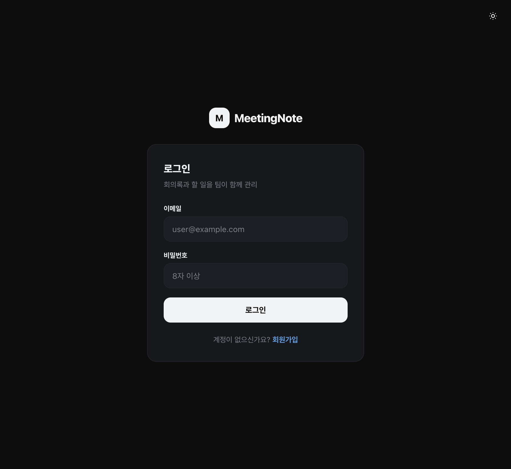
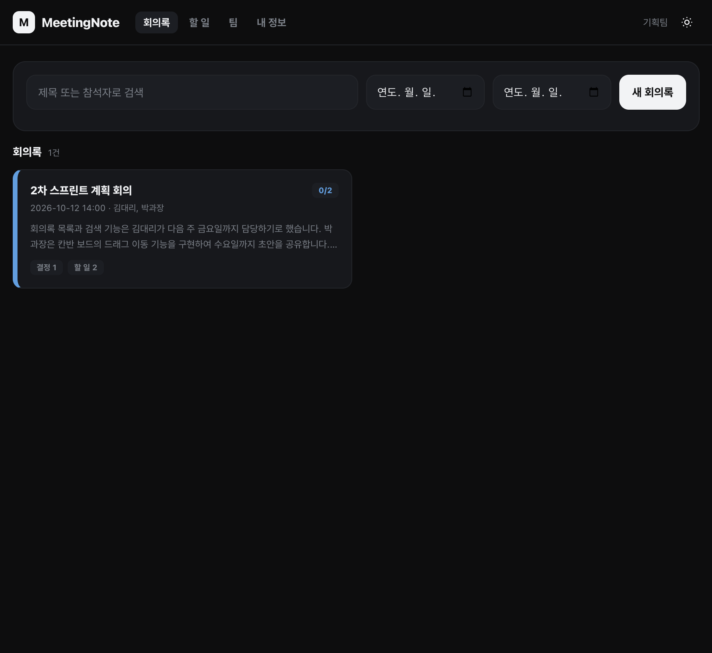
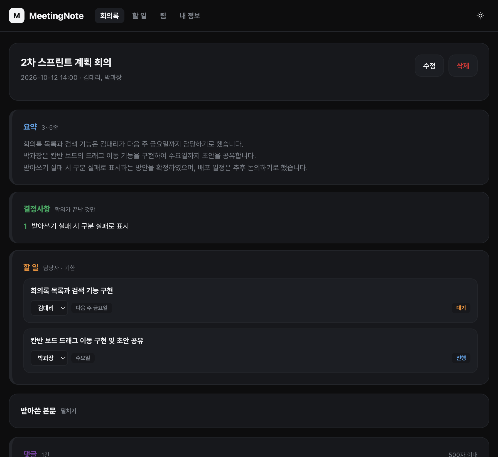
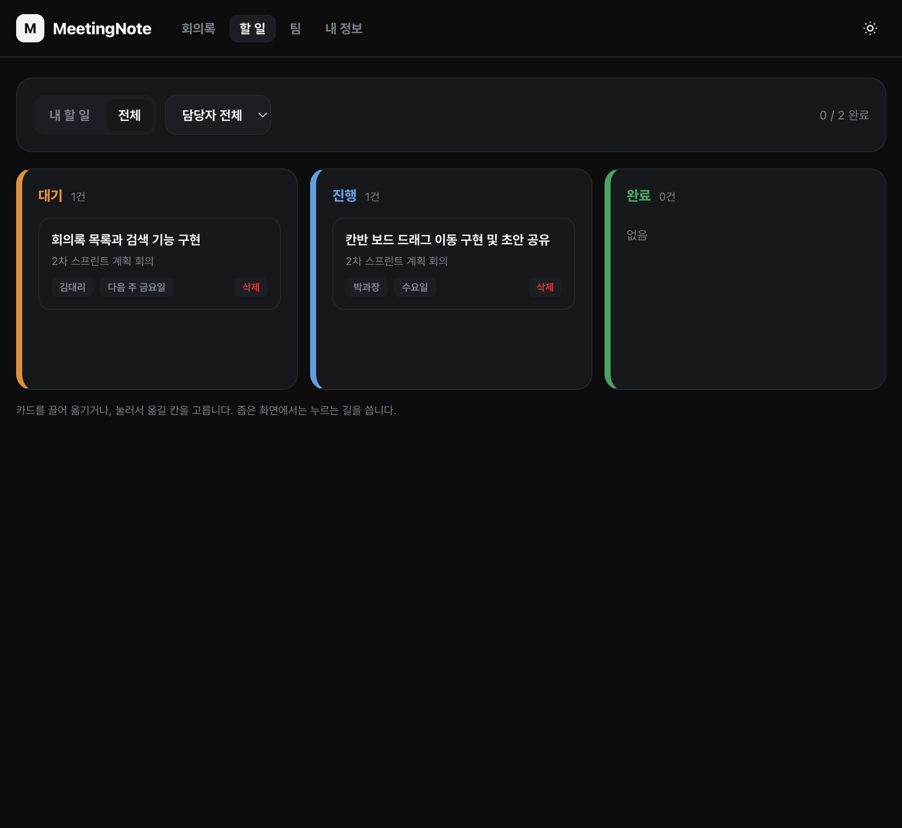
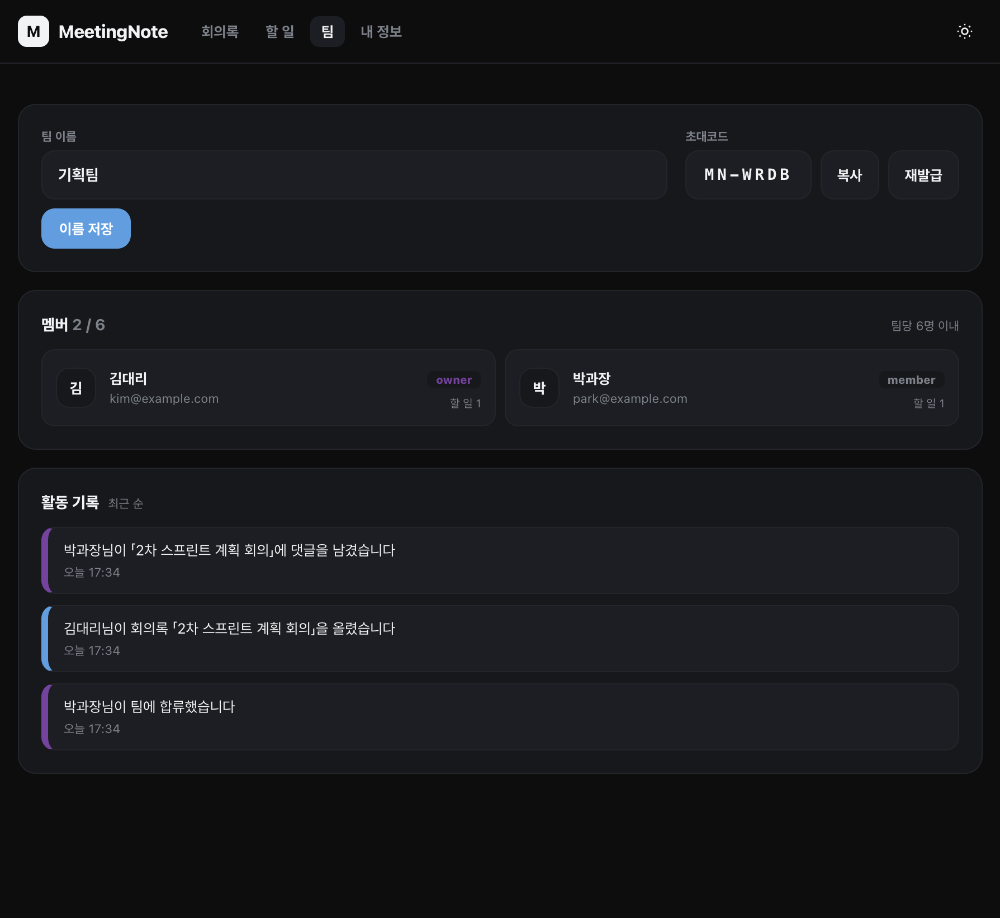
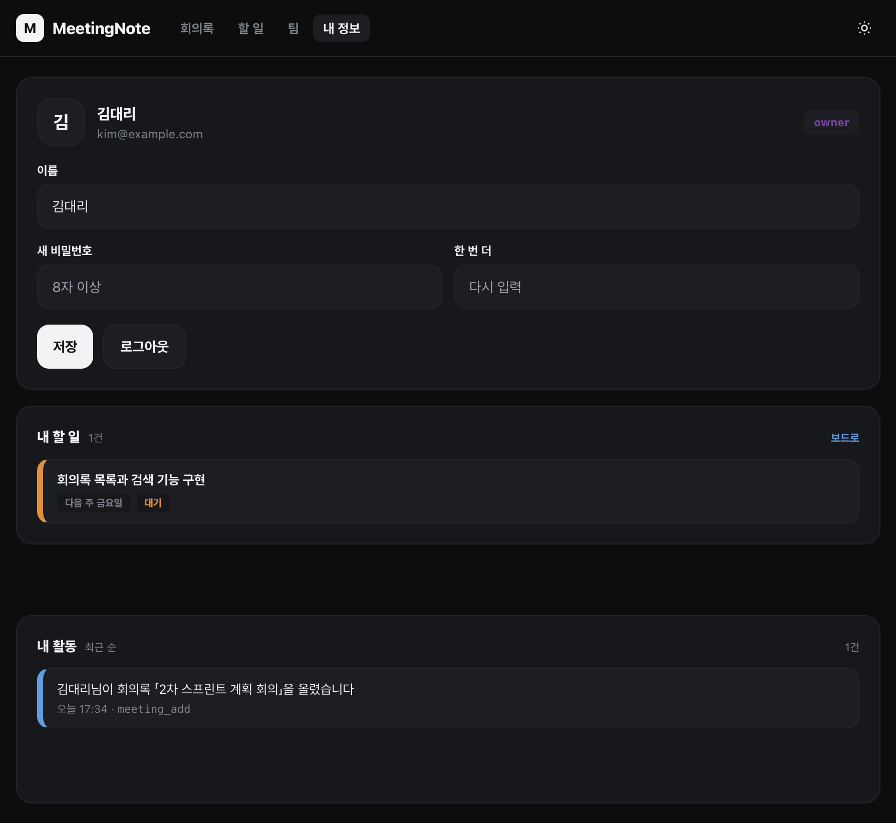
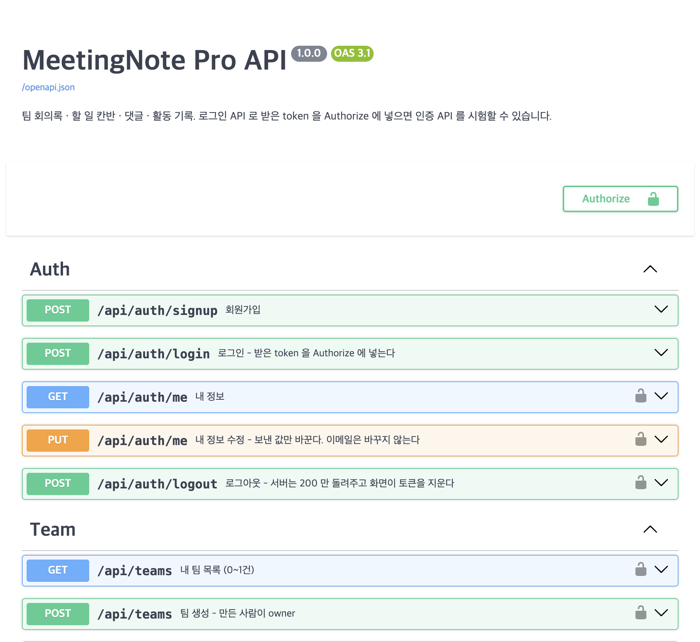

# MeetingNote Pro

팀이 회의록을 올리면 AI가 **요약 · 결정사항 · 할 일** 세 항목으로 나눠 주고, 할 일은 칸반 보드에서 담당자와 진행 상태로 관리하는 웹앱입니다.
FastAPI 서버 하나가 API, 화면, Swagger UI를 함께 제공합니다(로컬 일체형).

- 기능 6종: 인증 · 팀 · 회의록 · 할 일 · 댓글 · 활동 기록
- API 26개 (`/api/…`), 화면 6종, DB 7테이블
- 받아쓰기와 세 항목 구분: Google Gemini API
- 테스트: pytest 130개 (외부 AI 호출은 가짜로 바꿔 API 키 없이 돌아갑니다)

---

## 화면

### 1. 로그인 · 회원가입 — `login.html`



- 이메일과 비밀번호(8자 이상)로 로그인합니다. 아래 **회원가입** 링크로 같은 화면에서 가입 폼으로 바뀝니다.
- 로그인하면 JWT(24시간)를 받아 브라우저 `localStorage`에 보관합니다.
- 토큰이 만료되거나 위조되면 서버가 `401 TOKEN_EXPIRED`를 돌려주고, 화면은 토큰을 지운 뒤 `login.html?expired=1`로 보냅니다. 이때 위쪽에 **세션 만료** 안내가 뜹니다.
- 오른쪽 위 해 모양 버튼으로 라이트 · 다크 테마를 바꿉니다. 모든 화면에 같은 버튼이 있습니다.

### 2. 회의록 목록 — `meetings.html`



- 내 팀의 회의록을 카드로 보여 줍니다. 카드마다 회의 일시 · 참석자 · 요약 앞부분 · 결정사항 수 · 할 일 수가 나오고, 오른쪽 위 `0/2`는 **완료한 할 일 / 전체 할 일**입니다.
- 위쪽 검색창은 제목과 참석자로 찾고, 날짜 두 칸으로 기간을 좁힙니다 (`GET /api/teams/{team_id}/meetings?q=&from=&to=`).
- **새 회의록**을 누르면 회의 내용을 직접 붙여 넣거나 녹취 파일(mp3 · wav, 25MB 이하)을 올립니다. 녹취는 Gemini로 받아쓴 뒤 본문 칸에 채워집니다.
- 저장하는 순간 서버가 본문을 Gemini에 보내 세 항목으로 나눕니다.
- 팀이 없는 사용자는 팀 만들기 · 초대코드 합류 화면을 먼저 봅니다.

### 3. 회의록 상세 — `detail.html`



- **요약**: 3~5줄로 정리한 회의 내용
- **결정사항**: 합의가 끝난 것만 번호를 붙여 보여 줍니다.
- **할 일**: 무엇을 · 누가 · 언제까지. 담당자는 드롭다운으로 팀원 중에서 다시 고를 수 있고, 오른쪽 배지는 칸반 상태(대기 · 진행 · 완료)입니다.
- **받아쓴 본문**: 원문은 접어 두었다가 **펼치기**로 봅니다.
- **댓글**: 500자 이내. 내가 쓴 댓글만 지울 수 있습니다.
- 위쪽 **수정 · 삭제**는 쓴 사람과 팀 owner만 할 수 있습니다(서버가 막습니다). 수정은 제목 · 시각 · 참석자 · 본문만 바꾸며, 세 항목은 다시 나누지 않습니다. 삭제하면 딸린 할 일과 댓글도 함께 지워집니다.

### 4. 할 일 칸반 — `todos.html`



- 팀의 할 일을 **대기 · 진행 · 완료** 세 칸으로 보여 줍니다.
- 카드를 끌어 다른 칸에 놓으면 상태가 바뀝니다 (`PUT /api/todos/{todo_id}`). 좁은 화면(360px)에서는 카드를 눌러 옮길 칸을 고릅니다.
- 위쪽에서 **내 할 일 / 전체**, **담당자**로 거르고, 오른쪽에 완료 개수가 나옵니다.
- 카드에는 어느 회의에서 나온 할 일인지, 담당자, 기한이 붙습니다.

### 5. 팀 — `team.html`



- **팀 이름**을 바꾸고, **초대코드**(`MN-XXXX`)를 복사하거나 재발급합니다. 재발급하면 이전 코드로는 들어올 수 없습니다. 이름 변경과 재발급은 owner만 할 수 있습니다.
- **멤버**: 팀당 6명까지. 역할(owner · member)과 맡은 할 일 수를 보여 줍니다.
- **활동 기록**: 팀 합류, 회의록 등록, 댓글, 할 일 상태 변경 같은 일이 최근 순으로 쌓입니다.

### 6. 내 정보 — `profile.html`



- 이름과 비밀번호를 바꿉니다. 이메일은 바꿀 수 없습니다.
- 내 활동 기록이 이 화면에 함께 나옵니다.

### 7. API 문서 (Swagger UI) — `/docs`



- API 26개를 Auth · Team · Meeting · Todo · Comment · Activity 묶음으로 보여 줍니다.
- 사용법:
  1. `POST /api/auth/login` → **Try it out** → 이메일 · 비밀번호 입력 → **Execute**
  2. 응답의 `token` 값을 복사
  3. 위쪽 **Authorize** 버튼 → `HTTPBearer` 칸에 토큰 붙여넣기 → **Authorize**
  4. 자물쇠가 잠긴 API(인증 필요)도 이제 바로 호출할 수 있습니다. 예: `GET /api/auth/me` → 200

---

## 빠르게 실행하기

Python 3.11 이상이 필요합니다.

```bash
# 1. 가상환경과 패키지
python3 -m venv .venv
source .venv/bin/activate
pip install -r requirements.txt

# 2. 환경 변수
cp .env.example .env
# .env 를 열어 JWT_SECRET 과 STT_API_KEY(Gemini API 키)를 채웁니다

# 3. 서버 실행
python -m uvicorn backend.app.main:app --reload --port 8000
```

브라우저에서 엽니다.

| 주소 | 내용 |
|---|---|
| http://127.0.0.1:8000/ | 로그인 화면으로 이동 |
| http://127.0.0.1:8000/docs | Swagger UI |
| http://127.0.0.1:8000/openapi.json | OpenAPI 스펙 |

### 환경 변수 (`.env`)

| 이름 | 설명 | 기본값 |
|---|---|---|
| `JWT_SECRET` | JWT 서명 키. 32자 이상의 긴 무작위 문자열을 권장합니다 | `dev-only-secret-change-me` |
| `STT_API_KEY` | Gemini API 키 ([Google AI Studio](https://aistudio.google.com/)). 받아쓰기와 세 항목 구분에 씁니다 | 없음 |
| `DATABASE_URL` | 비우면 로컬 SQLite(`meetingnote.db`). Postgres 주소를 넣으면 그 DB를 씁니다 | 비어 있음 |
| `CORS_ORIGINS` | 쉼표로 구분한 허용 출처 | `http://127.0.0.1:8000,http://localhost:8000` |
| `STT_MODEL` · `LLM_MODEL` | Gemini 모델 이름 | `gemini-3.1-flash-lite` |

`STT_API_KEY`가 없으면 녹취 업로드는 **받아쓰기 실패**로 끝납니다. 회의록 저장은 세 항목 구분이 실패해도 본문만 담아 저장되고, 요약 · 결정사항 · 할 일은 비어 있습니다.

---

## 테스트

```bash
python -m pytest -q
```

- 130개 테스트가 API 26개의 정상 흐름, 권한(owner · member · 다른 팀), 입력 검증, 에러 코드, 화면 파일 구성, Swagger 경로 수를 확인합니다.
- Gemini 호출은 테스트에서 가짜로 바뀌므로 API 키와 네트워크 없이 돌아갑니다.
- 테스트마다 임시 폴더에 SQLite를 새로 만들어 로컬 `meetingnote.db`를 건드리지 않습니다.

| 파일 | 다루는 것 |
|---|---|
| `tests/test_auth.py` | 가입 · 로그인 · 토큰 만료 · 위조 토큰 · 내 정보 |
| `tests/test_teams.py` | 팀 생성 · 합류 · 6명 제한 · 초대코드 재발급 · owner 권한 |
| `tests/test_meetings.py` | 회의록 CRUD · 검색 · 업로드 · 세 항목 구분 |
| `tests/test_todos.py` | 칸반 상태 · 담당자 변경 · 삭제 |
| `tests/test_comments_activities.py` | 댓글과 활동 기록 5종 |
| `tests/test_ai.py` | Gemini 응답 파싱, 받아쓰기(작은 파일 · 큰 파일), 실패 처리 |
| `tests/test_errors.py` | `/` 리다이렉트, 없는 API 경로의 에러 형식 |
| `tests/test_docs.py` | `/docs`와 API 26개 |
| `tests/test_frontend.py` | 화면 6종 제공, 퍼블리싱 마크업과 일치, 목업 · STATE 바 제거 |
| `tests/test_flow.py` | 팀장 가입부터 팀원 합류 · 할 일 처리까지 이어지는 흐름 |

---

## API 요약

인증이 필요한 API는 `Authorization: Bearer <token>` 헤더를 붙입니다. 에러는 `{"code": "...", "msg": "..."}` 형식입니다.

| 묶음 | 메서드 · 경로 | 설명 |
|---|---|---|
| Auth | `POST /api/auth/signup` | 회원가입 (토큰과 사용자 반환) |
| | `POST /api/auth/login` | 로그인 |
| | `GET · PUT /api/auth/me` | 내 정보 조회 · 수정 |
| | `POST /api/auth/logout` | 로그아웃 |
| Team | `GET · POST /api/teams` | 내 팀 · 팀 만들기 |
| | `POST /api/teams/join` | 초대코드로 합류 |
| | `GET /api/teams/{team_id}/members` | 멤버 목록 |
| | `PUT /api/teams/{team_id}` | 팀 이름 변경 (owner) |
| | `PUT /api/teams/{team_id}/code` | 초대코드 재발급 (owner) |
| Meeting | `GET · POST /api/teams/{team_id}/meetings` | 목록 · 검색 / 생성 (세 항목 구분) |
| | `GET · PUT · DELETE /api/meetings/{meeting_id}` | 단건 · 수정 · 삭제 |
| | `POST /api/upload` | 녹취 업로드 → 받아쓰기 |
| Todo | `GET /api/teams/{team_id}/todos` | 팀 할 일 |
| | `GET /api/me/todos` | 내 할 일 |
| | `PUT · DELETE /api/todos/{todo_id}` | 상태 · 담당자 · 기한 변경 / 삭제 |
| Comment | `GET · POST /api/meetings/{meeting_id}/comments` | 댓글 목록 · 등록 |
| | `DELETE /api/comments/{comment_id}` | 댓글 삭제 (작성자) |
| Activity | `GET /api/teams/{team_id}/activities` | 팀 활동 기록 |
| | `GET /api/me/activities` | 내 활동 기록 |

전체 요청 · 응답 형식은 서버를 띄운 뒤 `/docs`에서 확인할 수 있습니다.

---

## 폴더 구조

```
meetingnote-pro/
├── backend/app/
│   ├── main.py          # FastAPI 앱 - 라우터 · 정적 화면 · Swagger
│   ├── config.py        # .env 읽기
│   ├── db.py · models.py  # SQLAlchemy 엔진과 7개 테이블
│   ├── security.py      # bcrypt · JWT
│   ├── ai.py            # Gemini 받아쓰기 · 세 항목 구분
│   ├── activity.py      # 활동 기록 남기기
│   ├── errors.py        # 공통 에러 응답
│   └── routers/         # auth · teams · meetings · todos · comments · activities
├── frontend/            # 화면 6종 + api.js(토큰 · 호출 · 세션 만료) + theme.js
├── tests/               # pytest 130개
├── publish/             # 디자인 원본 퍼블리싱 HTML
├── docs/                # 프로그램정의서 · 스토리보드 · 디자인시스템 PDF, 결정기록, 화면 캡처
└── openspec/            # 요구사항 스펙 (specs/) 과 지난 변경 기록 (changes/archive/)
```

## 기술 스택

- **백엔드**: FastAPI · SQLAlchemy 2 · PyJWT · bcrypt
- **AI**: Google Gemini (`google-genai`) - 받아쓰기, 요약 · 결정사항 · 할 일 구분
- **DB**: SQLite (기본) / Postgres (`DATABASE_URL`, psycopg)
- **프런트엔드**: HTML + Tailwind 클래스 + 바닐라 JS (빌드 없음), 라이트 · 다크 테마, 360px 반응형
- **테스트**: pytest · httpx

## 문서

- `docs/MeetingNote Pro_프로그램정의.pdf` - 기능 범위와 데이터
- `docs/MeetingNote Pro_스토리보드.pdf` - 화면 6종과 상태 62종, API 매핑표
- `docs/MeetingNote Pro_디자인시스템.pdf` - 색 · 글꼴 · 컴포넌트
- `docs/결정기록.md` - 구현 전에 정한 것들
- `openspec/specs/` - 기능별 요구사항과 시나리오 8종
